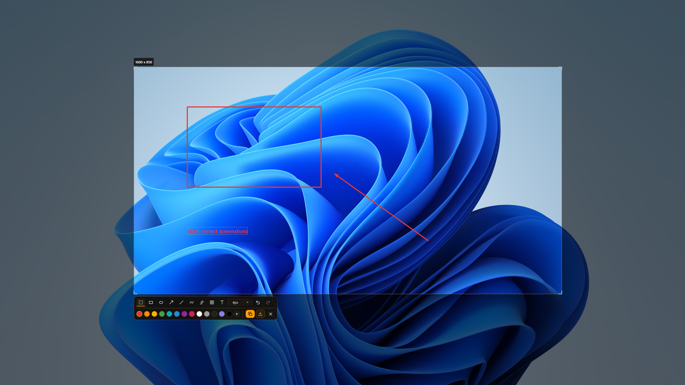

# RoeSnip: HDR screenshot tool and screen recorder for Windows, Linux and macOS

[](LICENSE)
[](https://github.com/roe69/roesnip/releases/latest)
[](#download)
[](https://dotnet.microsoft.com/)

RoeSnip is a free, open source snipping tool and screen recorder that takes
**HDR-correct screenshots**. Press PrintScreen, the screen dims instantly, drag
a region, annotate, then copy, save or upload. Recordings go to MP4 or GIF.
It runs on **Windows, Linux and macOS**.

On an HDR display Windows composites in linear scRGB FP16, and legacy tools
(Snipping Tool, PrintScreen, Lightshot, ShareX's default path) clip or
mis-scale that buffer, so screenshots come out washed-out, gray or blown out.
RoeSnip captures the true FP16 frame and tone-maps it properly, so a capture
looks like what you saw on screen.



## Download

**[Get the latest release](https://github.com/roe69/roesnip/releases/latest)**,
then pick the file for your system from the Assets list at the bottom of that
page. No .NET install is needed.

| Your system | Download | Then |
|---|---|---|
| Windows 10 (2004+) or 11 | `RoeSnip.exe` | Double-click it. RoeSnip starts in the system tray. |
| Windows on ARM | `RoeSnipApp-win-arm64.exe` | Same as above. |
| Linux, Intel / AMD (64-bit) | `RoeSnip-linux-x64.AppImage` | Make it executable (right-click, Properties, Allow executing; or `chmod +x`), run it, then pick **Install RoeSnip** in the tray menu. |
| Linux, ARM | `RoeSnip-linux-arm64.AppImage` | Same as above. |
| Mac with Apple silicon (M1 or newer) | `RoeSnip-osx-arm64.dmg` | Open the dmg, then right-click RoeSnip and choose Open the first time. |
| Mac with an Intel chip | `RoeSnip-osx-x64.dmg` | Same as above. |

**Your first capture:** press **PrintScreen**, drag over the part of the screen
you want, then press Ctrl+C to copy it (or use the toolbar to save, annotate or
record it). Press Esc to cancel. On Windows, RoeSnip asks once whether it may
take PrintScreen over from the Snipping Tool; say no and it uses
Ctrl+PrintScreen instead. You can change the hotkey in Settings from the tray
icon.

**Updates:** an installed copy checks GitHub Releases in the background and
updates itself. On Windows a copy you just double-click from Downloads is
portable and does not update; use **Install RoeSnip** in the tray menu to turn
updates on. On Linux and macOS the same **Install RoeSnip** menu item installs
it and starts it at login. The Linux `.tar.gz` build (for systems without
FUSE) only shows a notice when a new version is out.

Linux and macOS have a few one-time permission steps (Wayland screen sharing,
macOS Screen Recording): see [Linux](#linux) and [macOS](#macos).

## Actively developed: report bugs, request features, send fixes

RoeSnip is under active development and new releases come out often.

- **Found a bug or want a feature?** [Open an issue](https://github.com/roe69/roesnip/issues/new).
  Say which OS and version you use, what you did and what you expected.
- **Fixed something?** Pull requests are welcome: [open a pull request](https://github.com/roe69/roesnip/pulls).
  See [CONTRIBUTING.md](CONTRIBUTING.md) for how to build and test.

Attach the log file to a bug report if you can. It records each capture and
any error:

| OS | Log file |
|---|---|
| Windows (`RoeSnip.exe`) | `%APPDATA%\RoeSnip\roesnip.log` |
| Windows (`RoeSnipApp-win-*.exe`) | `%APPDATA%\RoeSnip.App\roesnip.log` |
| Linux | `~/.config/roesnip-app/roesnip.log` (or under `$XDG_CONFIG_HOME/roesnip-app/`) |
| macOS | `~/Library/Application Support/RoeSnip.App/roesnip.log` |

The previous log is kept next to it as `roesnip.log.1`.

## Features

- **HDR done right (Windows).** SDR content (the common case) comes out
  pixel-identical to a plain SDR monitor's screenshot: an exact pass-through,
  matched to the "SDR content brightness" level. Genuine HDR highlights get a
  smooth, hue-preserving rolloff instead of blowing out. Optionally saves the
  untouched HDR original as a `.jxr` alongside the PNG, the way Xbox Game Bar
  does.
- **Instant response.** A resident tray process with pre-provisioned capture
  sessions and overlay windows: the dim lands in single-digit milliseconds
  and the interactive overlay opens in under 100 ms, warm or cold.
- **Annotations.** Rectangle, ellipse, arrow, line, freehand, highlighter,
  pixelate (censor mosaic), and text in any installed font. Every placed
  shape stays editable: click it under any tool to move it, drag its handles
  or endpoints, scroll to adjust its stroke/mosaic/font size, with full
  undo/redo.
- **Color picker.** A plain click inspects the pixel under the cursor into a
  compact picker window (hex / RGB / HSL / nits, HDR-aware).
- **Screen recording.** Record the selected region to MP4 or GIF straight
  from the overlay toolbar. A small floating control bar shows elapsed time
  and lets you stop and save or cancel. Pressing PrintScreen again while
  recording stops and saves it.
- **Share.** Upload a snip to your default share provider with Ctrl+U.
- **Multi-monitor.** One overlay per monitor, per-monitor HDR state and SDR
  white levels, capture via Desktop Duplication with a
  Windows.Graphics.Capture fallback per monitor.
- **CLI modes.** Headless `--capture` and per-monitor `--diag` HDR
  diagnostics on Windows, plus `capture` / `settings` verbs on Linux.
- **Self-updating.** An installed copy updates itself from GitHub Releases.

### What works on which OS

| | Windows 10 2004+ / 11 | Linux (X11, Wayland) | macOS |
|---|---|---|---|
| HDR-correct capture | Yes (verified on real HDR monitors) | Not attempted: captures are SDR | Requests the HDR screenshot preset on macOS 15+ (Apple silicon); SDR on older macOS |
| Save untouched HDR original (.jxr) | Yes | No | No |
| Annotations, picker, MP4 / GIF recording | Yes | Yes | Yes |

## FAQ

### Why are my screenshots washed out on HDR?
With HDR on, Windows composites the desktop in linear scRGB FP16 at HDR
brightness levels. Tools that treat that buffer as ordinary 8-bit sRGB clip
the highlights and mis-scale the midtones, so the result looks gray, faded or
blown out. RoeSnip reads the FP16 frame and tone-maps it: SDR content is
scaled by your "SDR content brightness" setting to the exact SDR result, and
only real HDR highlights are rolled off.

### How do I take a screenshot in HDR on Windows 11?
Install RoeSnip, press PrintScreen, drag a region, then copy or save. For the
HDR original as well, enable the automatic HDR copy in Settings (it writes a
`.jxr` next to the PNG), or use `RoeSnip.exe --capture --jxr` from a terminal.

### Is there an HDR screenshot fix for the Snipping Tool?
RoeSnip replaces it for this purpose. On first run it asks whether to take
over PrintScreen from the Snipping Tool or use Ctrl+PrintScreen instead.

### Can I record my screen in HDR?
Recordings are saved as MP4 or GIF from the tone-mapped frames, so colors
match RoeSnip's screenshots. They are SDR files, not HDR video.

### Is RoeSnip a Lightshot alternative?
It covers the same workflow (hotkey, drag a region, annotate, copy, save,
upload) and adds correct HDR handling on Windows plus MP4/GIF recording.

### Does it work on Linux and macOS?
Yes, see [Linux](#linux) and [macOS](#macos). HDR tone-mapping is
Windows-only so far: Linux captures are SDR, and macOS uses the HDR
screenshot preset only on macOS 15+ on Apple silicon.

### Is it free?
Yes. MIT licensed and open source.

## Using it on Windows

Run `RoeSnip.exe` with no arguments to start the tray app; PrintScreen opens
the capture overlay. If Windows currently intercepts PrintScreen for Snipping
Tool, RoeSnip asks once whether to disable that or use Ctrl+PrintScreen
instead. The hotkey can be changed later from the tray icon's Settings
window. Launching the exe again triggers a capture on the running instance.

The tray menu keeps the last capture reachable: **Copy again** puts it back on the
clipboard after something else has taken it, and **Save last capture** writes it to
the save directory. Both appear only while a capture is being held - it lives in
memory, one at a time, until the next capture replaces it or RoeSnip exits.

In the overlay, Ctrl+C copies the snip and Ctrl+U uploads it to your default
share provider. Both keys can be changed under Settings, Snip shortcuts.

Settings live at `%APPDATA%\RoeSnip\settings.json` (hotkey, save directory,
auto-HDR-copy, tone-map overrides, run-at-startup, copy-on-select, snip
shortcuts). A missing
or corrupt file falls back to defaults in memory without being overwritten,
so it can always be inspected or repaired by hand.

### CLI

```sh
RoeSnip.exe --diag
RoeSnip.exe --capture [--monitor N] [--out shot.png] [--jxr]
```

- `--diag` prints per-monitor diagnostics (device, resolution, Advanced Color
  on/off, SDR white level, max luminance) and exits.
- `--capture` captures one or all monitors headlessly, writes PNGs, prints
  min/max/avg captured nits, and with `--jxr` also writes the untouched HDR
  original next to each PNG.

## Linux

The cross-platform build (`src/RoeSnip.App`) ships per release as
`RoeSnip-linux-x64.AppImage` / `RoeSnip-linux-arm64.AppImage`, plus a
`RoeSnip-linux-<arch>.tar.gz` of the publish folder for distros without FUSE.
Run it with no arguments to start the tray app, or `./RoeSnip capture` /
`./RoeSnip settings` to trigger the capture flow or open the settings window
(starting a resident instance on first run, signaling the existing one
afterward).

Install: run the AppImage and pick **Install RoeSnip** in the tray menu. It
moves itself to `~/.local/share/RoeSnip/RoeSnip.AppImage` (respects
`XDG_DATA_HOME`), adds an application menu entry
(`~/.local/share/applications/net.roelite.roesnip.desktop`, with a Capture
action) and starts at login (`~/.config/autostart/net.roelite.roesnip.desktop`,
toggle in Settings). The installed AppImage updates itself from GitHub
Releases. The tar.gz build only shows a notice when a new version is out.

**Wayland hotkey.** The hotkey hook (SharpHook/libuiohook) is X11-only, so on
Wayland RoeSnip never starts it. On GNOME it adds a custom keybinding
`roesnip` that runs `<RoeSnip or $APPIMAGE> capture` (no dialog), unless
another custom shortcut already uses that key. gnome-shell grabs Print,
Shift+Print and Alt+Print for its own screenshot tool, so RoeSnip clears
GNOME's binding for the hotkey's key and keeps the old value to restore it.
Settings' "PrintScreen opens RoeSnip (replaces the system screenshot key)"
(on by default) turns this off: GNOME gets its key back and RoeSnip moves to
Ctrl+PrintScreen. On other desktops (KDE Plasma 6, Hyprland) RoeSnip binds
shortcut `capture` ("Take a screenshot") through the
`org.freedesktop.portal.GlobalShortcuts` portal, which shows the desktop's
dialog. Changing the hotkey in Settings re-binds it. When nothing works,
RoeSnip shows a one-time notice; bind a desktop shortcut to the
`RoeSnip capture` CLI verb by hand:

- **GNOME:** Settings - Keyboard - View and Customize Shortcuts - Custom
  Shortcuts - add one with command `/path/to/RoeSnip capture`.
- **KDE:** System Settings - Shortcuts - Custom Shortcuts - add a new
  global shortcut that runs `/path/to/RoeSnip capture`.

X11 sessions are unaffected: the hook starts normally there and the
PrintScreen hotkey works as on Windows.

**Wayland instant capture.** Instant screenshots read a kept-open screen
share. Its dialog never opens on its own: the first PrintScreen (or
Settings' "Allow instant capture" button) shows the desktop's share dialog
(pick all monitors / Entire screen, then Share) and the capture follows once
allowed. After that the share reopens silently on every start. The desktop's
screenshot tool (shutter sound and screen flash) is never used on GNOME, and
elsewhere only when the desktop has no screen-share support.

## macOS

Releases ship `RoeSnip-osx-arm64.dmg` (Apple silicon) and
`RoeSnip-osx-x64.dmg` (Intel). The app is only ad-hoc signed: right-click >
Open the first time. Pick **Install RoeSnip** in the tray menu to copy it to
`~/Applications/RoeSnip.app` and start it at login
(`~/Library/LaunchAgents/net.roelite.roesnip.plist`, toggle in Settings). The
installed copy updates itself from GitHub Releases. The ad-hoc signature
changes with every build, so macOS may ask for Screen Recording permission
again after an update.

## Contributing and building from source

Build, test and project layout notes are in [CONTRIBUTING.md](CONTRIBUTING.md).
Design docs: [DESIGN.md](DESIGN.md) (behavioral spec), [DESIGN-XPLAT.md](DESIGN-XPLAT.md)
(cross-platform port) and [TESTING.md](TESTING.md) (what has been verified, per OS).

## License

[MIT](LICENSE).
